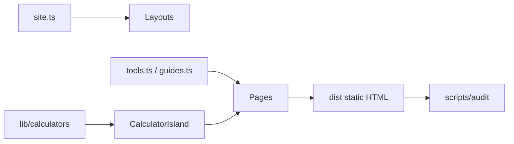

# AGENTS.md — YardTally contributor & AI agent guide

This repository is a **production** static site of free home & garden material calculators (brand: **YardTally**). It is optimized for Google ranking, AI-search citations, AdSense readiness, and mobile Core Web Vitals.

## Governing documents

| Doc | Role |
|---|---|
| [docs/SEO-PLAYBOOK.md](docs/SEO-PLAYBOOK.md) | Governing SEO / GEO / technical rules |
| [docs/SEO-GUARDRAILS.md](docs/SEO-GUARDRAILS.md) | Do/don’t rules + CI failure conditions |
| [docs/PAGE-CHECKLIST.md](docs/PAGE-CHECKLIST.md) | Per-page SEO/AEO checklist (CI: `audit:pages`) |
| [docs/CUSTOM-DOMAIN.md](docs/CUSTOM-DOMAIN.md) | Custom domain cutover (`PUBLIC_SITE_URL`) |
| [docs/CONFIGURATION.md](docs/CONFIGURATION.md) | Brand / env var reference |
| [docs/MARKET-RESEARCH.md](docs/MARKET-RESEARCH.md) | Niche research & AdSense eligibility notes |
| [docs/ideas/README.md](docs/ideas/README.md) | All 23 ideas index + home/garden add-on backlog |
| [docs/KEYWORD-MAP.md](docs/KEYWORD-MAP.md) | Primary keyword per live URL |
| [docs/SEO-GUIDE.md](docs/SEO-GUIDE.md) | Launch & post-launch SEO ops |
| [docs/ADSENSE.md](docs/ADSENSE.md) | AdSense + CMP enablement |
| [docs/DEPLOYMENT.md](docs/DEPLOYMENT.md) | Hosting |
| [docs/CONTACT-EMAILJS.md](docs/CONTACT-EMAILJS.md) | Optional EmailJS contact form (public env IDs) |

Cursor-specific: `.cursor/skills/*/SKILL.md`, `.cursor/rules/*.mdc`, `.cursor/agents/*.md`.

### Skills (start here for common tasks)

| Skill | Use for |
|---|---|
| [add-a-new-calculator](.cursor/skills/add-a-new-calculator/SKILL.md) | New tool end-to-end |
| [add-a-new-guide](.cursor/skills/add-a-new-guide/SKILL.md) | New guide end-to-end |
| [refresh-an-existing-guide](.cursor/skills/refresh-an-existing-guide/SKILL.md) | Rewrite/refresh one guide |
| [pre-merge-seo-aeo-checklist](.cursor/skills/pre-merge-seo-aeo-checklist/SKILL.md) | Before opening/updating a PR |
| [ui-ux-pro-max](.cursor/skills/ui-ux-pro-max/SKILL.md) | Any visual/UX change |

---

## Standing rules (do not re-learn)

### Agent / PR workflow
- **One concern per PR** (content ≠ CMP/consent ≠ calculator SEO ≠ docs). Fresh branch from `main`: `cursor/<name>-c2d2`.
- Open PRs with `ManagePullRequest`; **do not merge** unless asked.
- Seasonality: publish evergreen DIY content **Nov–Feb** ahead of **Mar–Jun** peaks (lawn, mulch, concrete, paint).

### Content voice & facts
- Human, contractor-practical. Ban AI filler (“delve”, “in today’s world”, “whether you’re a beginner or…”, “unlock”, “comprehensive guide”, etc.). Full list: `.cursor/rules/content-quality.mdc`.
- **No invented stats.** Every number needs a manufacturer TDS or extension URL.
- Guides: Sources list + visible `Reviewed by Hammad Iqbal · Last updated {date}`.
- Tools: Sources via `TrustBlock`; FAQ 3–5 sourced items.

### Guide structure
- `answerFirst` 40–60 words (sourced verdict first).
- Question H2s from real search/PAA questions; worked example; FAQ in `guideFaqs.ts`.
- Bodies in `guideBodies.ts` (≥800 words). HowTo only in `guideHowTo.ts` when steps are on-page.

### Calculator structure
- Math in `src/lib/calculators/` + Vitest; UI in `Calculator.astro`; registry in `tools.ts` + `toolBodies.ts`.
- SSR default results from `calculatorFields.ts` (real numbers in HTML — no em-dash placeholders).
- HowTo from on-page steps via `src/data/toolHowTo.ts` (add the registry + page wiring if missing).

### Schema
- Tools: WebApplication + FAQPage (`toolPageGraph`). Guides: Article + FAQPage.
- **HowTo JSON-LD only from visible steps** — never invent steps for schema.
- No fake `aggregateRating`.

### Sitemap, IndexNow, llms
- Sitemap `lastmod` = each page’s real `dateModified` (`astro.config.mjs`). **Never** `Date.now()` / “now”.
- After deploy: IndexNow (`npm run indexnow` / `deploy:indexnow`).
- Keep `src/pages/llms.txt.ts` (Q→URL) and `llms-full.txt.ts` (figures) in sync; `/.well-known/llms.txt` aliases `/llms.txt`.

### Consent & CSP
- Consent Mode v2: **denied by default** in EEA/UK/CH until CMP updates (`BaseLayout.astro`, `gdprRegions.ts`).
- EEA/UK/CH → **Google AdSense / Funding Choices message only**; elsewhere → site cookie bar (`docs/ADSENSE.md`).
- CSP allowlist lives in `public/_headers` with comments per host family (GA4, AdSense/FC, CF Analytics). **Do not loosen broadly.**

---

## UI/UX Pro Max

Use this skill for **any change to how the site looks or behaves** (layout, components, colors, typography, motion, forms, nav, dark mode, responsive behavior). Skip it for pure math/content/SEO copy with no UI impact.

1. Read [`.cursor/skills/ui-ux-pro-max/SKILL.md`](.cursor/skills/ui-ux-pro-max/SKILL.md).
2. Search the local design intelligence:

```bash
python3 .cursor/skills/ui-ux-pro-max/scripts/search.py "<query>" --domain <domain>
```

**Priority checks before shipping UI:** contrast ≥ 4.5:1 (light + dark); touch targets ≥ 44×44px; `:focus-visible`; labeled inputs; no horizontal scroll at 360px; `prefers-reduced-motion`.

---

## Project overview

- **Stack:** Astro 5 (static) + TypeScript, Vitest for calculator math, minimal client JS (calculator island).
- **Config:** `src/config/site.ts` + `src/config/siteDefaults.mjs` (**only** place for origin / brand fallbacks). Canonical origin = `PUBLIC_SITE_URL` → `siteConfig.siteUrl`. Never hardcode the hostname elsewhere.
- **Math:** `src/lib/calculators/` — never duplicate formulas in copy without matching tests.
- **Registries:** `src/data/tools.ts`, `src/data/guides.ts` (+ `guideBodies` / `guideFaqs` / `guideHowTo`, `toolBodies` / `toolHowTo`, `calculatorFields`).
- **Pages:** `src/pages/` (dynamic `[slug].astro` for tools/guides/hubs).



---

## Research first (any new or reworked page)

1. One primary query + SERP/PAA review.
2. Intent: do / know / compare / navigate — match tool, guide, or hub.
3. Cannibalization check in [`docs/KEYWORD-MAP.md`](docs/KEYWORD-MAP.md).
4. Follow [`docs/PAGE-CHECKLIST.md`](docs/PAGE-CHECKLIST.md) (also `.cursor/rules/seo-pages.mdc`).
5. Answer-first ≤60 words before first input (tools) or numeric answer (guides/hubs).

CI: `npm run audit:pages` (in `npm run audit`).

---

## How to add a new tool / guide

Follow the skills (file lists are authoritative):

- Calculator → [`.cursor/skills/add-a-new-calculator/SKILL.md`](.cursor/skills/add-a-new-calculator/SKILL.md)
- Guide → [`.cursor/skills/add-a-new-guide/SKILL.md`](.cursor/skills/add-a-new-guide/SKILL.md)
- Refresh guide → [`.cursor/skills/refresh-an-existing-guide/SKILL.md`](.cursor/skills/refresh-an-existing-guide/SKILL.md)

---

## Quality bar / definition of done

- [ ] `npm test` · `npm run build` · `npm run audit` · `npm run check:links`
- [ ] Pre-merge checklist skill completed
- [ ] Keyword map updated; no intent cannibalization
- [ ] Mobile OK at 360px; tap targets ≥48px preferred
- [ ] IndexNow planned for after deploy

PR CI (`.github/workflows/ci.yml`) = **build + unit tests** only. Full audits / Lighthouse via **Actions → Full checks** or locally.

---

## Commands

| Command | Purpose |
|---|---|
| `npm run dev` | Local dev server |
| `npm run build` | Production static build → `dist/` |
| `npm run preview` | Preview `dist/` |
| `npm test` | Vitest unit tests |
| `npm run check:links` | Internal link check on `dist/` |
| `npm run audit` | SEO + AdSense + perf + pages |
| `npm run indexnow` | Ping IndexNow with sitemap URLs |
| `npm run lighthouse` / `npm run proof` | Lighthouse CI / full proof bundle |

---

## Subagent roles (mirror of `.cursor/agents/`)

| Role | Focus |
|---|---|
| **seo-auditor** | Titles, canonicals, schema, keyword map, orphans |
| **content-writer** | Tool/guide copy, answer-first, citations |
| **adsense-reviewer** | Trust pages, thin content, ads.txt, privacy, CMP |
| **performance-auditor** | JS weight, LCP/CLS budgets, ad slot sizing |
| **link-builder-researcher** | Resource pages, embed distribution, outreach angles |

---

## Ideas backlog

See [docs/ideas/README.md](docs/ideas/README.md) for niches and add-on tools (stair stringer, sod, pool volume, etc.).
