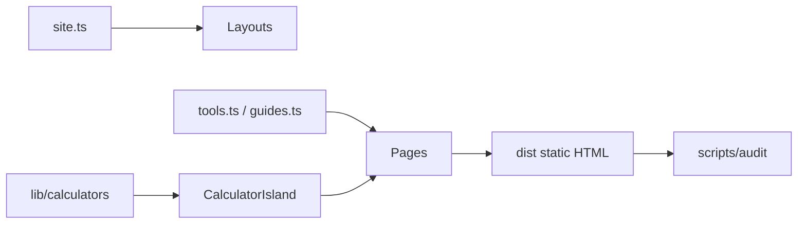

# AGENTS.md — YardCalc contributor & AI agent guide

This repository is a **production** static site of free home & garden material calculators (brand placeholder: **YardCalc**). It is optimized for Google ranking, AI-search citations, AdSense readiness, and mobile Core Web Vitals.

## Governing documents

| Doc | Role |
|---|---|
| [docs/SEO-PLAYBOOK.md](docs/SEO-PLAYBOOK.md) | Governing SEO / GEO / technical rules |
| [docs/SEO-GUARDRAILS.md](docs/SEO-GUARDRAILS.md) | Do/don’t rules + CI failure conditions |
| [docs/CUSTOM-DOMAIN.md](docs/CUSTOM-DOMAIN.md) | Custom domain cutover (`PUBLIC_SITE_URL`) |
| [docs/MARKET-RESEARCH.md](docs/MARKET-RESEARCH.md) | Niche research & AdSense eligibility notes |
| [docs/ideas/README.md](docs/ideas/README.md) | All 23 ideas index + home/garden add-on backlog |
| [docs/KEYWORD-MAP.md](docs/KEYWORD-MAP.md) | Primary keyword per live URL |
| [docs/SEO-GUIDE.md](docs/SEO-GUIDE.md) | Launch & post-launch SEO ops |
| [docs/ADSENSE.md](docs/ADSENSE.md) | AdSense enablement |
| [docs/DEPLOYMENT.md](docs/DEPLOYMENT.md) | Hosting |

Cursor-specific: `.cursor/skills/*/SKILL.md`, `.cursor/rules/*.mdc`, `.cursor/agents/*.md`.

---

## Project overview

- **Stack:** Astro 5 (static) + TypeScript, Vitest for calculator math, minimal client JS (calculator island).
- **Config:** `src/config/site.ts` (brand, AdSense, GA4, IndexNow, contact) + `src/config/site-origin.mjs` (**only** place for this site’s workers.dev fallback). Canonical origin = `PUBLIC_SITE_URL` → `siteConfig.siteUrl` everywhere. Never hardcode the site hostname elsewhere — CI fails. Cutover: [docs/CUSTOM-DOMAIN.md](docs/CUSTOM-DOMAIN.md).
- **Math:** pure functions in `src/lib/calculators/` — never duplicate formulas in page copy without matching tests.
- **Content registries:** `src/data/tools.ts`, `src/data/guides.ts`.
- **Pages:** file routes under `src/pages/` (dynamic `[slug].astro` for tools/guides/hubs).

### Architecture (summary)

---

## How to add a new tool page (step-by-step)

1. **Pick a unique intent** — check `docs/KEYWORD-MAP.md` and `docs/ideas/README.md` add-on backlog. No cannibalizing an existing primary keyword.
2. **Implement math** in `src/lib/calculators/<name>.ts` (pure functions, imperial+metric via `src/lib/units.ts`).
3. **Add Vitest cases** in `tests/calculators.test.ts` (or colocated `*.test.ts`). Formulas must be verified.
4. **Export** from `src/lib/calculators/index.ts`.
5. **Wire UI** in `src/components/Calculator.astro` (`configs` map + `calculatorId`).
6. **Register the tool** in `src/data/tools.ts` with:
   - unique `primaryKeyword`, secondaries, title (<60), description (<155)
   - `answerFirst` (40–60 words), `sectionsHtml` (600–1200 words worth of unique HTML), FAQ, sources
   - `relatedSlugs` / `relatedGuideSlugs`, dates, `applicationCategory`
7. **Update keyword map** `docs/KEYWORD-MAP.md`.
8. **Hub:** ensure `category` maps to an existing hub in `categories`.
9. **Optional embed:** set `embeddable: true` (route `/embed/<slug>/`).
10. **Internal links:** from hub, related tools, and at least one guide.
11. **Run:** `npm test && npm run build && npm run audit`.
12. Follow skill: `.cursor/skills/add-new-tool/SKILL.md`.

### Tool content template (minimum sections)

- H1 + answer-first paragraph  
- Working calculator above the fold  
- How it works / formula / worked example / table  
- Tips + common mistakes + FAQ (real questions)  
- Sources (extension services / manufacturers)  
- Author box + last updated  

---

## How to add a guide / article

1. Add entry to `src/data/guides.ts` with unique primary keyword.
2. Link ≥2 related tools; add reciprocal links from those tools’ `relatedGuideSlugs`.
3. Use Article JSON-LD (already in `guides/[slug].astro`).
4. Update `docs/KEYWORD-MAP.md` and content calendar in `docs/SEO-GUIDE.md` if shipping a planned piece.
5. Skill: `.cursor/skills/write-seo-article/SKILL.md`.

---

## Content / SEO / AdSense rules (from playbook)

- Tool above the fold; ads never push it away on mobile.
- One H1; keyword-near-start title; unique meta description.
- No scaled content / doorway URL variants.
- Cite authoritative sources; show dates.
- FAQ visible for users/AI—do not depend on FAQ rich results (removed May 2026).
- Privacy must keep AdSense cookie + opt-out language.
- No fake aggregate ratings in JSON-LD.

---

## Quality bar / definition of done

A change is done when:

- [ ] `npm test` passes (math covered)
- [ ] `npm run build` passes
- [ ] `npm run audit` passes (SEO + AdSense + budgets)
- [ ] `npm run check:links` passes
- [ ] New/changed pages meet word-count and metadata budgets
- [ ] Mobile layout OK at 360px (no horizontal scroll; tap targets ≥48px)
- [ ] Keyword map updated; no intent cannibalization
- [ ] PR description notes any Lighthouse scores for touched templates

---

## Commands

| Command | Purpose |
|---|---|
| `npm run dev` | Local dev server |
| `npm run build` | Production static build → `dist/` |
| `npm run preview` | Preview `dist/` |
| `npm test` | Vitest unit tests |
| `npm run check:links` | Internal link check on `dist/` |
| `npm run audit:seo` | SEO auditor |
| `npm run audit:adsense` | AdSense readiness |
| `npm run audit:perf` | Performance budget check on `dist/` |
| `npm run audit` | All auditors |
| `npm run lighthouse` | Lighthouse CI (mobile) |

---

## Subagent roles (mirror of `.cursor/agents/`)

| Role | Focus |
|---|---|
| **seo-auditor** | Titles, canonicals, schema, keyword map, orphans |
| **content-writer** | Tool/guide copy, answer-first, citations |
| **adsense-reviewer** | Trust pages, thin content, ads.txt, privacy |
| **performance-auditor** | JS weight, LCP/CLS budgets, ad slot sizing |
| **link-builder-researcher** | Resource pages, embed distribution, outreach angles |

---

## Ideas backlog

See [docs/ideas/README.md](docs/ideas/README.md) for all 23 niches and home/garden add-on tools (stair stringer, sod, pool volume, etc.).
