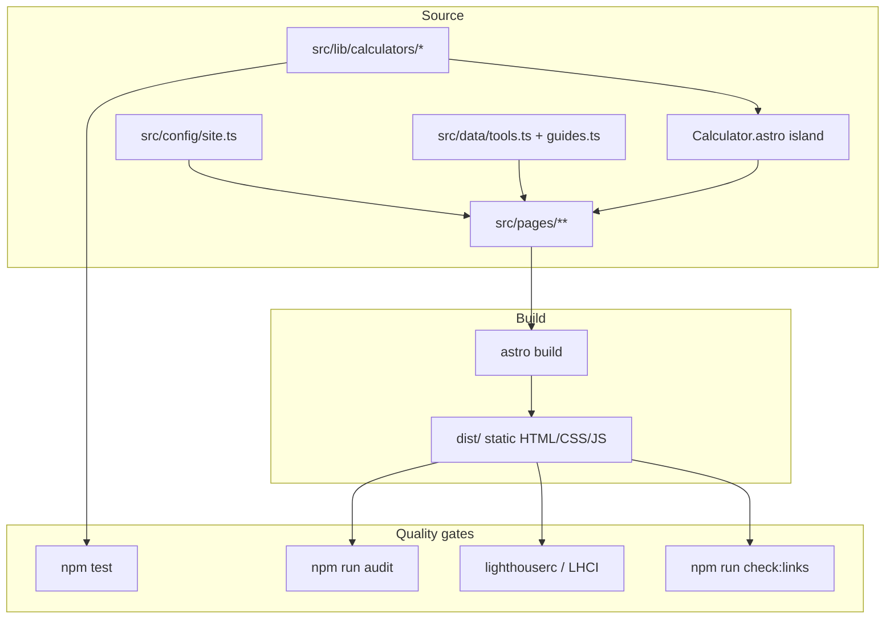

# YardCalc — Home & Garden Material Calculators

Production-ready **static** website of free DIY / landscaping material calculators. Built to rank in Google, be citable by AI search, pass AdSense review, and stay fast on mobile.

**Placeholder brand:** YardCalc · **Config:** [`src/config/site.ts`](src/config/site.ts)  
**Governing research:** [`docs/SEO-PLAYBOOK.md`](docs/SEO-PLAYBOOK.md) · [`docs/MARKET-RESEARCH.md`](docs/MARKET-RESEARCH.md) · [`docs/ideas/README.md`](docs/ideas/README.md)

---

## Goals

- Ship working calculators (US imperial + metric) with **correct, unit-tested formulas**
- Pair every tool with original, cited explanatory content (AdSense-safe depth)
- Perfect technical SEO (canonicals, sitemap, robots, JSON-LD, CWV budgets)
- Stay agent-friendly: `AGENTS.md`, Cursor skills/rules/agents, runnable auditors, CI

---

## Live tool list

| Tool | Path | Primary keyword |
|---|---|---|
| Concrete calculator | [`/calculators/concrete-calculator/`](src/pages/calculators/[slug].astro) | concrete calculator |
| Post holes concrete | `/calculators/concrete-calculator-post-holes/` | concrete calculator for post holes |
| Sonotube / columns | `/calculators/sonotube-concrete-calculator/` | sonotube concrete calculator |
| Mulch | `/calculators/mulch-calculator/` | mulch calculator |
| Tree ring mulch | `/calculators/mulch-calculator-tree-rings/` | mulch calculator for tree rings |
| Gravel | `/calculators/gravel-calculator/` | gravel calculator |
| Topsoil | `/calculators/topsoil-calculator/` | topsoil calculator |
| Sand | `/calculators/sand-calculator/` | sand calculator |
| Pavers | `/calculators/paver-calculator/` | paver calculator |
| Fence materials | `/calculators/fence-calculator/` | fence calculator |
| Deck materials | `/calculators/deck-material-calculator/` | deck material calculator |
| Roof pitch | `/calculators/roof-pitch-calculator/` | roof pitch calculator |
| Roofing shingles / squares | `/calculators/roofing-shingles-calculator/` | roofing calculator |
| Paint | `/calculators/paint-calculator/` | paint calculator |
| Retaining wall blocks | `/calculators/retaining-wall-calculator/` | retaining wall calculator |
| Grass seed | `/calculators/grass-seed-calculator/` | grass seed calculator |
| Fertilizer | `/calculators/fertilizer-calculator/` | fertilizer calculator |
| Raised bed soil | `/calculators/raised-bed-soil-calculator/` | raised bed soil calculator |

**Hubs:** `/hubs/concrete/` · `/hubs/landscape/` · `/hubs/outdoor-structures/` · `/hubs/lawn/`  
**Guides:** `/guides/` (concrete bags, fence posts, mulch depth, driveway gravel, roof pitch)  
**Full keyword map:** [`docs/KEYWORD-MAP.md`](docs/KEYWORD-MAP.md)  
**Ideas backlog (23 niches + add-ons):** [`docs/ideas/README.md`](docs/ideas/README.md)

---

## Tech stack

- [Astro 5](https://astro.build/) static output + TypeScript
- Vitest for calculator math
- `@astrojs/sitemap` for XML sitemap index
- Minimal client JS (calculator island only)
- Deployable to Cloudflare Pages (primary), Vercel, or Netlify

### Architecture



---

## Folder structure

```
├── AGENTS.md                 # Agent/human contributor guide
├── README.md
├── astro.config.mjs
├── lighthouserc.cjs
├── package.json
├── vercel.json
├── .cursor/
│   ├── agents/               # Subagent role definitions
│   ├── rules/                # SEO, content, perf, a11y rules
│   └── skills/               # Step-by-step skills
├── .github/workflows/ci.yml
├── docs/
│   ├── ADSENSE.md
│   ├── DEPLOYMENT.md
│   ├── KEYWORD-MAP.md
│   ├── MARKET-RESEARCH.md
│   ├── SEO-GUIDE.md
│   ├── SEO-PLAYBOOK.md
│   └── ideas/                # Compiled ideas research index
├── public/                   # robots.txt, ads.txt, _headers, llms.txt, icons
├── scripts/
│   ├── audit/                # seo, adsense, perf auditors
│   ├── check-links.mjs
│   └── indexnow.mjs
├── src/
│   ├── components/
│   ├── config/site.ts        # ONLY place for brand/domain/IDs
│   ├── data/
│   ├── layouts/
│   ├── lib/calculators/
│   ├── pages/
│   └── styles/global.css
└── tests/
```

---

## Prerequisites

- Node.js **20+** (22 recommended)
- npm 9+

---

## Local setup

```bash
git clone <repo-url>
cd home-garden-calculators
npm install
npm run dev
```

Open the printed localhost URL. Edit `src/config/site.ts` before any public launch.

**Deploy to production:** step-by-step domain, Cloudflare Pages / Vercel / Netlify, Search Console, AdSense, and launch checklist — **[`docs/DEPLOYMENT.md`](docs/DEPLOYMENT.md)**.

---

## Scripts / commands

| Command | Description |
|---|---|
| `npm run dev` | Dev server with HMR |
| `npm run build` | Production build → `dist/` |
| `npm run preview` | Serve `dist/` locally |
| `npm test` | Vitest calculator unit tests |
| `npm run test:watch` | Vitest watch mode |
| `npm run check:links` | Broken internal link check on `dist/` |
| `npm run audit:seo` | SEO auditor (titles, H1, canonical, JSON-LD, orphans…) |
| `npm run audit:adsense` | AdSense readiness auditor |
| `npm run audit:perf` | First-party JS gzip budget (≤50KB/page) |
| `npm run audit` | Run all auditors |
| `npm run lighthouse` | Lighthouse CI mobile budgets (`lighthouserc.cjs`) |
| `npm run proof` | Regenerate committed proof under `docs/proof/` (Lighthouse, audits, screenshots) |
| `npm run indexnow -- <url>` | Ping IndexNow for URL(s) |

---

## Configuration

All owner-specific values live in **`src/config/site.ts`** (no scattered hardcoded brand/domain).

| Key | Purpose | Before launch |
|---|---|---|
| `name` | Brand display name | Set final brand |
| `tagline` | Short description | Optional tweak |
| `siteUrl` | From `PUBLIC_SITE_URL` (fallback: workers.dev) | Set in Workers Builds |
| `contactEmail` | mailto + trust pages | **Required** |
| `contentUpdated` | Default lastmod / stamps | Keep ISO date current |
| `author.*` | E-E-A-T byline | Replace placeholder bio |
| `sameAs` | Organization `sameAs` profile URLs | Add when available |
| `analytics.ga4MeasurementId` | GA4 `G-…` | Optional until analytics |
| `analytics.searchConsoleVerification` | GSC HTML tag content | Optional (DNS preferred) |
| `adsense.publisherId` | `ca-pub-…` | After approval |
| `adsense.enabled` | Master ads switch | `false` until approved |
| `adsense.autoAds` | Google Auto ads | Documented; default off |
| `indexNowKey` | IndexNow key + `public/<key>.txt` | Replace placeholder |
| `locale` | `lang` attribute | Keep `en-US` unless expanding |
| `defaultOgImage` | OG image path in `/public` | Replace creative optional |

Also update after domain purchase:

- `public/robots.txt` → `Sitemap:` line  
- `public/llms.txt` URLs  
- `public/_redirects` host redirects  
- `public/ads.txt` when AdSense is live  

**Env vars:** none required at runtime (static site). Hosts may set `NODE_VERSION=20` for builds (see [`docs/DEPLOYMENT.md`](docs/DEPLOYMENT.md)).

---

## Adding a tool or article

Follow **[`AGENTS.md`](AGENTS.md)** and:

- `.cursor/skills/add-new-tool/SKILL.md`
- `.cursor/skills/write-seo-article/SKILL.md`

Math belongs in `src/lib/calculators/` with tests; page SEO/content in `src/data/tools.ts` / `guides.ts`; keyword row in `docs/KEYWORD-MAP.md`.

---

## Testing

```bash
npm test                 # formula correctness
npm run build
npm run check:links
npm run audit            # SEO + AdSense + perf budgets
```

---

## Proof

Committed, tool-generated evidence (scores are **not** hand-edited): **[`docs/proof/README.md`](docs/proof/README.md)**.

```bash
npm run build && npm run proof
```

Includes Lighthouse HTML/JSON, structured-data samples, audit logs, bundle-size table, mobile screenshots (360px & 768px), and AdSense readiness checklist. CI job **`proof`** on pull requests regenerates the bundle and uploads `docs/proof/` as an artifact.

---

## Audits & CI

- Auditors: `scripts/audit/*.mjs` wired via `npm run audit`
- Lighthouse CI config: `lighthouserc.cjs` (mobile, Performance/A11y/BP/SEO ≥ 0.95, CLS ≤ 0.05)
- GitHub Actions: [`.github/workflows/ci.yml`](.github/workflows/ci.yml) runs install → test → build → links → audit → lighthouse on PRs, plus **`proof`** (full evidence bundle artifact)

---

## Performance budgets

| Metric | Budget |
|---|---|
| Lighthouse Performance (mobile) | ≥ 95 |
| LCP | < 2.5s (aim < 2.0s) |
| CLS | < 0.05 |
| TBT | < 150ms (warn) |
| First-party JS / page (gzip) | ≤ 50 KB |

System fonts, reserved ad slots, hashed assets, `_headers` long-cache for `/assets/*`.

---

## SEO & AI-search approach (summary)

- One intent per URL ([`docs/KEYWORD-MAP.md`](docs/KEYWORD-MAP.md))
- Tool above the fold → answer-first paragraph → formula/examples/FAQ/sources
- Hub clusters + breadcrumbs + related modules (≤3 clicks)
- JSON-LD: WebSite, Organization, BreadcrumbList, WebApplication, Article
- `robots.txt` allows search + AI-search crawlers; training bots allowed with documented choice
- Optional `llms.txt` (Google ignores it)
- Full playbook: [`docs/SEO-PLAYBOOK.md`](docs/SEO-PLAYBOOK.md)

---

## AdSense setup (summary)

1. Ship 20–30 quality pages + some traffic  
2. Fill publisher ID and set `adsense.enabled: true`  
3. Uncomment `public/ads.txt`  
4. Install certified CMP before personalized ads in EEA/UK/CH  

Details: [`docs/ADSENSE.md`](docs/ADSENSE.md)

---

## Deployment quick start

```bash
npm run build   # output: dist/
```

Primary: **Cloudflare Pages** (build `npm run build`, output `dist`).  
Also: Vercel / Netlify. Custom domain, HTTPS, www redirects: **[`docs/DEPLOYMENT.md`](docs/DEPLOYMENT.md)**.

---

## Post-launch SEO steps

See **[`docs/SEO-GUIDE.md`](docs/SEO-GUIDE.md)**:

1. Google Search Console domain property + DNS verification  
2. Submit `sitemap-index.xml`  
3. URL Inspection / request indexing for home, hubs, top tools  
4. Bing Webmaster import + IndexNow key  
5. GA4 measurement ID in config  
6. 90-day content/link plan  

---

## Docs index

| Doc | Description |
|---|---|
| [`AGENTS.md`](AGENTS.md) | Architecture, add-tool steps, quality bar, subagent roles |
| [`docs/SEO-PLAYBOOK.md`](docs/SEO-PLAYBOOK.md) | Governing SEO/GEO playbook |
| [`docs/MARKET-RESEARCH.md`](docs/MARKET-RESEARCH.md) | Market research report |
| [`docs/ideas/README.md`](docs/ideas/README.md) | All 23 ideas + add-on backlog index |
| [`docs/ideas/ideas.csv`](docs/ideas/ideas.csv) | Ranked ideas spreadsheet |
| [`docs/ideas/MORE-IDEAS.md`](docs/ideas/MORE-IDEAS.md) | Round-2 ideas #12–23 |
| [`docs/KEYWORD-MAP.md`](docs/KEYWORD-MAP.md) | Primary keyword per URL |
| [`docs/SEO-GUIDE.md`](docs/SEO-GUIDE.md) | Launch checklist & 90-day plan |
| [`docs/DEPLOYMENT.md`](docs/DEPLOYMENT.md) | Cloudflare/Vercel/Netlify |
| [`docs/ADSENSE.md`](docs/ADSENSE.md) | AdSense enablement |
| [`.cursor/skills/*/SKILL.md`](.cursor/skills/) | Agent skills (add-tool, audits, etc.) |
| [`.cursor/agents/*.md`](.cursor/agents/) | seo-auditor, content-writer, adsense-reviewer, performance-auditor, link-builder-researcher |
| [`.cursor/rules/*.mdc`](.cursor/rules/) | SEO, content, performance, accessibility rules |

---

## AI agents / skills / auditors overview

- **Skills** — actionable workflows under `.cursor/skills/` (add-new-tool, write-seo-article, keyword-research, seo-audit, ai-seo-geo-audit, adsense-readiness-audit, performance-cwv-audit, content-refresh, internal-linking, structured-data).
- **Rules** — always-on guidance for matching globs (SEO pages, content quality, perf budget, a11y).
- **Subagents** — role prompts in `.cursor/agents/` (mirrored in `AGENTS.md`).
- **Runnable auditors** — `npm run audit` over `dist/` so CI fails on regressions.

---

## Troubleshooting

| Problem | Fix |
|---|---|
| `dist/` missing for audits | Run `npm run build` first |
| Sitemap host wrong | Set `siteUrl` in `src/config/site.ts` and rebuild |
| Ads not showing | `adsense.enabled` must be true **and** real `ca-pub-` id (no `XXXX`) |
| LHCI Chrome missing locally | Install Chrome or rely on CI; `continue-on-error` until Chrome present |
| IndexNow 403/422 | Ensure `public/<key>.txt` matches `indexNowKey` on the live host |
| Orphan page in SEO audit | Add nav/hub/related links to the URL |
| Engine warning Node < 22.22 | Repo pinned to Astro 5 for Node 20+/22.14 compatibility |

---

## Roadmap

From [`docs/ideas/README.md`](docs/ideas/README.md) add-on backlog and [`docs/SEO-GUIDE.md`](docs/SEO-GUIDE.md) calendar:

1. Stair stringer, sod, pool volume/salt, grout, insulation, metal roof, firewood, propane  
2. Next 20 supporting articles (slab thickness, driveway gravel depth, joist spacing, …)  
3. Embed distribution + resource-page outreach  
4. AdSense application after traffic + page-count threshold  

Other niches (#2 marketplace fees, #3 pets, …) are **separate sites**, not bolted onto this hub.

---

## License

Copyright © YardCalc contributors. Source is provided for operating this calculator property.  
Calculator outputs are **estimates only**—verify with manufacturers, suppliers, and local building codes.  
Replace this section with your preferred license (e.g. MIT) before public open-source release if desired.
